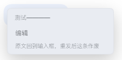

# dsh-edit-message

右键**最新一条**用户消息 → 编辑：原文回到输入框；重新发送后，新消息带一行标记，告诉模型上一条用户消息及其回答已作废。

DSH 的会话只追加、删除不了，所以用「作废」代替删除。标记在界面上显示为一枚绿色 `#编辑#` 胶囊。



## 用法

1. 右键**最新一条**用户消息 →「编辑」
2. 改完按 Enter 发送
3. 想反悔：点输入框左边的 `编辑中 ×`

只有最新一条能编辑——其它消息右键不弹菜单，这样「作废上一条」才不会有歧义。

## 安装

```bash
dsh plugin --profile desktop add github:starash07/dsh-edit-message
```

安装后重启客户端。

## 说明

- 只处理用户消息；助手消息请用它自带的分叉按钮。
- 旧消息不会变灰（DSH 的聊天行由框架渲染，插件改不动样式）。

## License

MIT
